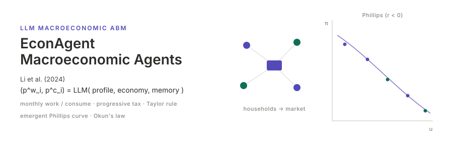

<p align="center"></p>

**English** | [日本語](README.ja.md)

# EconAgent: LLM-Empowered Agents for Simulating Macroeconomic Activities — Li et al. (2024)

A reimplementation of the LLM-driven macroeconomic agent-based model of Li et al. (2024), "EconAgent: Large Language Model-Empowered Agents for Simulating Macroeconomic Activities" (*ACL 2024*, 15523–15536; arXiv:2310.10436). A population of LLM-driven households each month makes two decisions — a *willingness to work* `p^w_i` and a *fraction of wealth to consume* `p^c_i` — based on a perception prompt fusing the agent's profile, the current macro variables, and its memory. These individual choices flow through a labour/goods market (production, demand, wage and price adjustment), a progressive tax with equal redistribution, and a Taylor-rule interest-rate policy. The paper's headline finding is that classical macro regularities — inflation, unemployment, the **Phillips curve** and **Okun's law** — *emerge from the bottom up* out of nothing but LLM semantic decisions, without hand-tuned rules or trained networks. The deterministic [socsim](https://github.com/akitenkrad/rs-social-simulation-tools) core handles household initialisation, the employment Bernoulli draws, the market-adjustment uniforms, scheduling and metrics, while the non-deterministic LLM layer is confined to the decision/reflection mechanisms and pseudo-determinised via the `socsim-llm` crate (prompt→response cache + `temperature=0` + fixed seed).

## Two-layer determinism (read this first)

LLM output is **outside** socsim's bit-reproducibility. The design therefore splits into two layers:

- **Deterministic socsim core** — household initialisation (Pareto wages, age distribution), employment Bernoulli draws, market-adjustment uniforms (`ctx.rng`, ChaCha20), scheduling, the fiscal/monetary accounting and all metrics. Given a seed this reproduces bit-for-bit.
- **Non-deterministic LLM layer** — the monthly work/consume decision and the quarterly reflection. Pseudo-determinised by `socsim-llm`'s `CachingClient` (a `hash(prompt+model)` → response cache), `temperature=0` and a fixed seed. The provider order is **Ollama first → OpenAI fallback** via `socsim-llm`'s `FallbackClient`.

The cache — not the model — is the reproducibility mechanism: a warm cache replays identical responses, so a rerun is free and stable (the paper notes one simulation cost ~$30 and ~2 hours). Each run records the model, provider and temperature in `run.json`'s `llm` block, and the call count and cache-hit rate as run-scope metrics. Because the local default model (`llama3.2`) differs from the paper's `gpt-3.5-turbo`, reproduction targets are **qualitative**: live-LLM runs test for a negative Phillips correlation, all runs test for a strong negative Okun correlation, and inflation/unemployment are checked against sanity ranges — not the exact `r = −0.619` / `r = −0.918`. The offline mock records the Phillips correlation but does not judge its sign.

> This project standardises on the `socsim-llm` crate for the LLM layer; it does **not** use `reqwest` (socsim-llm owns the HTTP transport). It needs no spatial grid or network (`socsim-grid` / `socsim-net`): the interaction is market-mediated, so it depends only on `socsim-core` + `socsim-engine` + `socsim-llm`.

## Install & Quick start

```bash
# Build the Rust simulation (fetches socsim incl. socsim-llm with the Ollama+OpenAI backends)
cargo build --release

# Make sure a local Ollama is running and a model is pulled, e.g.:
#   ollama pull llama3.2:latest
export OLLAMA_HOST=http://localhost:11434
export OLLAMA_MODEL=llama3.2:latest
# Optional OpenAI fallback:
#   export OPENAI_API_KEY=sk-...   OPENAI_MODEL=gpt-4o-mini

# Run a small simulation (a quick smoke; the paper uses N=100, months=240)
cargo run --release -- run --n-agents 4 --months 12 --seed 42

# Install the Python visualization tools (at the workspace root)
uv sync

# Visualize the most recent run (macro time series + Phillips/Okun scatter with Pearson r/p)
uv run econagent-tools visualize

# Inspect the run's settings and LLM metadata
uv run econagent-tools show-experiment-settings   # runvault resolves the latest run
```

### Offline (no-LLM) smoke

The full month loop, output writers and Python visualization can be exercised without any live LLM via a scripted mock client:

```bash
cargo run --release --example mock_smoke -- results
uv run econagent-tools visualize
```

**What the offline mock can and cannot check.** The scripted mock (`mock_decision_client`) gives every household the same work/consume reply, computed only from last month's unemployment and last year's inflation. Under it, Okun's law holds almost by construction — nominal GDP is employment × price, so a rise in unemployment lowers GDP growth in the same month (r ≈ −0.96 at N = 100, negative in 500 of 500 seeds) — and the tests assert it. The Phillips correlation does not: unemployment follows its own draws, independent of prices, and the annual inflation figure lags the months it is paired with, so the correlation is noise around zero (500 seeds, 60 months: mean +0.003, negative in 49%). The mock records it but does not judge it; whether a Phillips curve emerges is a question for runs with a live LLM. Under the mock the tax regime also leaves every macro aggregate unchanged (only the Gini differs), because all tax is redistributed and every household consumes the same share.

## Scratch runs

Use `--scratch` for development, debugging, and smoke-test runs. Scratch runs are created under `results/_scratch/`, are never synced to the vault, and the latest scratch run can be located with `runvault path --scratch`.

## Scope

The repository provides the `EconWorld` + five mechanisms over the six-phase loop, the LLM decision layer with Ollama→OpenAI fallback + caching, and the macro metrics. Three Rust subcommands drive it: `run` (a single configuration), `sweep` (a sensitivity analysis over agent count × tax-scale × LLM model), and `reproduce` (a one-shot batch of the headline scenarios that checks a strong negative Okun correlation in every mode and a negative Phillips correlation only with a live LLM). The Python `econagent-tools` (`visualize` / `visualize-sweep` / `show-experiment-settings` / `reproduce`) render the macro time series and the Phillips/Okun scatter with scipy Pearson `r`/`p`. The offline mock verifies the deterministic pipeline and the properties its construction supports; the Phillips-curve question remains for a live LLM. A COVID-19 external-intervention prompt and a deeper inequality (Gini) decomposition are kept as clean extension points.

## Documentation

- [Use cases](docs/usecases.md) — what you can do with this project, with pointers to the rest of the docs.
- [CLI](docs/cli.md) — the Rust CLI: the `run`, `sweep` and `reproduce` subcommands and their flags, plus the LLM environment variables.
- [Visualization](docs/visualization.md) — the Python `econagent-tools` and how to interpret the outputs (incl. Phillips/Okun).
- [Architecture](docs/architecture.md) — repository structure, the two-layer determinism, the socsim/`socsim-llm` framework, the mechanisms, the metrics, and references.

## License

MIT
